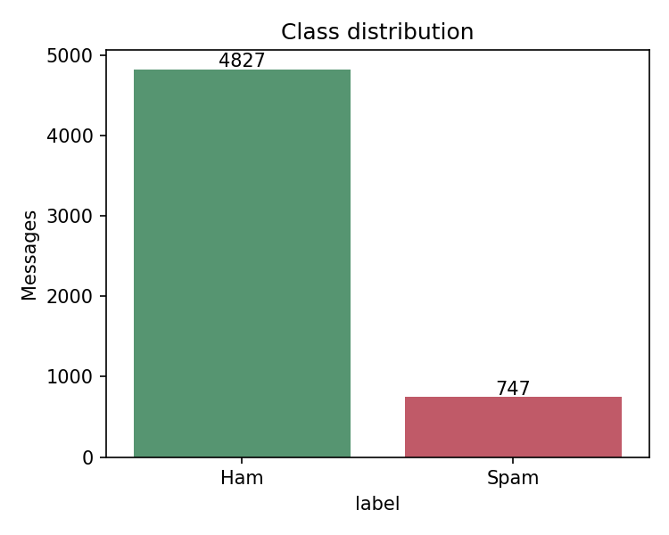
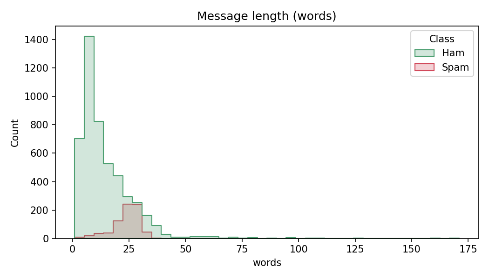
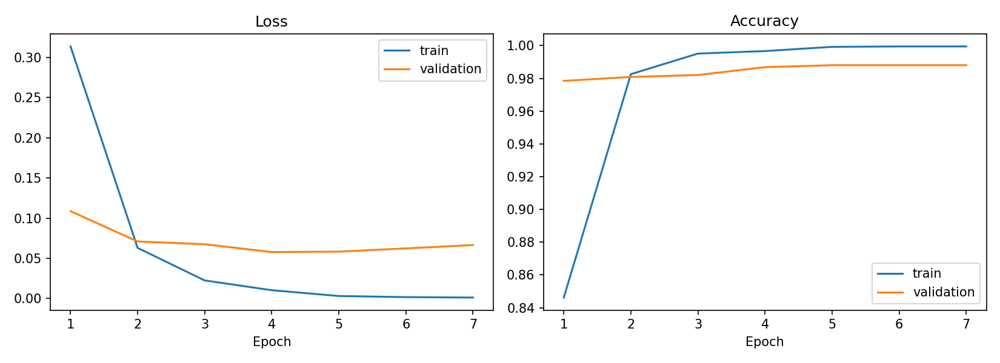
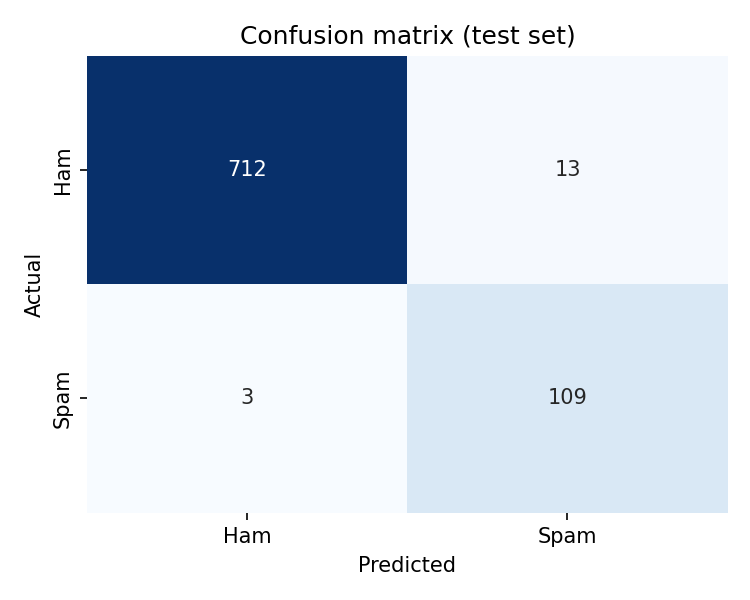
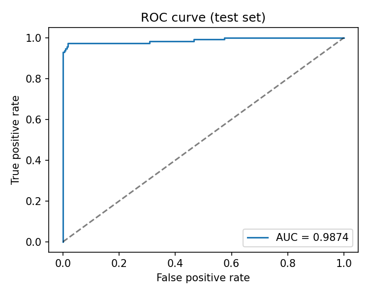

# Spam Detection Using Deep Learning
### Detecting spam messages with an Embedding + Bidirectional LSTM neural network

**Course:** _[Course name]_  **Student:** _[Your name / ID]_  **Date:** _[Submission date]_

---

## Abstract
Unsolicited spam messages waste time and carry scams and phishing links. This project builds a deep learning
classifier that labels a text message as *spam* or *ham* (not spam). An Embedding + Bidirectional LSTM network
was trained on the SMS Spam Collection (5,574 messages) using TensorFlow/Keras. On a held-out test set of 837
messages the model achieves **98.45 % accuracy**, **93.04 % precision**, **95.54 % recall**, **F1 = 94.27 %** for
the spam class and **ROC-AUC = 0.985**. The model is delivered with training, evaluation and prediction
scripts and a Streamlit web application.

## 1. Introduction
Spam is a long-standing problem for e-mail and mobile messaging. Rule-based filters (keyword lists, blacklists)
are easy for spammers to evade. Machine learning learns patterns from labelled examples instead. Deep learning
suits text because word embeddings capture meaning and recurrent networks such as the LSTM model word order
and context.

**Objectives**
1. Build a neural network that classifies messages as spam or ham.
2. Evaluate it properly on imbalanced data (precision, recall, F1, ROC-AUC, not accuracy alone).
3. Provide reusable code and a user-friendly web interface.

## 2. Dataset
The **SMS Spam Collection** (UCI Machine Learning Repository) contains 5,574 English messages:
4,827 ham (86.6 %) and 747 spam (13.4 %). The data is therefore **imbalanced**.

Spam messages are on average longer than ham messages and frequently contain phone numbers, prices, and
call-to-action words such as "free", "call", "claim", "prize".

## 3. Methodology
### 3.1 Preprocessing
Text is lower-cased; URLs, e-mail addresses, long digit sequences (phone numbers) and other numbers are replaced
by the tokens `urltoken`, `emailtoken`, `phonetoken`, `numtoken`, so the model can still learn that such
elements exist; remaining punctuation is removed. A vocabulary of at most 8,000 words (6,395 actually found) is built
from the **training split only** to avoid data leakage; unseen words map to an `<OOV>` id. Every message is
padded or truncated to 50 tokens.

### 3.2 Data split
A stratified split keeps the spam ratio equal in every subset: **70 % training (3,901)**, **15 % validation (836)**
and **15 % test (837)**. The test set is used only once, for the final evaluation. Random seed: 42.

### 3.3 Model architecture

| Layer | Output shape | Parameters |
|---|---|---|
| Embedding (vocabulary 6,395, dim 64, masking) | (50, 64) | 409,280 |
| Bidirectional LSTM (64 units per direction) | 128 | 66,048 |
| Dropout (0.4) | 128 | 0 |
| Dense (32, ReLU) | 32 | 4,128 |
| Dropout (0.2) | 32 | 0 |
| Dense (1, sigmoid) | 1 | 33 |
| **Total** | | **479,489** |

The **Embedding** layer turns each word id into a learned 64-dimensional vector. The **bidirectional LSTM**
reads the message forwards and backwards and summarises it in a 128-dimensional vector. **Dropout** reduces
over-fitting. The final **sigmoid** unit outputs P(spam); a message is classified as spam when P ≥ 0.5.

### 3.4 Training
Adam optimiser (learning rate 0.001), binary cross-entropy loss, batch size 32, up to 20 epochs. Because spam
is only 13 % of the data, **class weights** (ham 0.58, spam 3.73) make errors on spam count more.
**Early stopping** (patience 3, monitoring validation loss, restoring the best weights) stopped training after
7 epochs; the best epoch was epoch 4 (validation loss 0.051, validation accuracy 98.9 %).

Training accuracy approaches 100 % while validation loss stops improving after epoch 4, which is the typical
sign of the start of over-fitting; early stopping selected the weights before that point.

## 4. Results
Evaluation on the 837 unseen test messages:

| Class | Precision | Recall | F1 | Support |
|---|---|---|---|---|
| Ham | 0.9931 | 0.9890 | 0.9910 | 725 |
| Spam | 0.9304 | 0.9554 | 0.9427 | 112 |
| **Accuracy** | | | **0.9845** | 837 |

ROC-AUC = **0.985**.

The confusion matrix shows 717 ham and 107 spam messages classified correctly, 8 ham messages wrongly flagged as
spam (false positives) and 5 spam messages missed (false negatives): **13 errors out of 837**.

### 4.1 Error analysis
Errors are listed in `models/misclassified.csv`. False positives are mostly very short, casual messages
("Have you been practising your curtsey?", "Mathews or tait or edwards or anderson") that contain words rarely
seen in ham. False negatives include spam that is conversational ("Sorry I missed your call let's talk when you
have the time...") or that uses heavy abbreviation and unusual spelling.

### 4.2 Threshold trade-off
The notebook (section 6) shows that lowering the decision threshold increases recall but lowers precision. For a
real mail system, false positives (blocking real messages) are usually more costly than missed spam, so a
threshold above 0.5 may be preferable.

## 5. Application
`app.py` is a Streamlit web app: the user pastes a message and receives the label, a confidence value and a
spam-probability bar; a second tab classifies a whole CSV file (column `text`) and lets the user download the
results. `predict.py` offers the same function in the command line.

## 6. Limitations and future work
- The dataset is small, English-only and from around 2012; modern phishing may differ.
- Results come from a single split; k-fold cross-validation would give confidence intervals.
- Future work: pre-trained embeddings (GloVe/Word2Vec), transformer models (BERT/DistilBERT), character-level
  features for obfuscated words, an e-mail dataset (Enron-Spam), and multilingual support.

## 7. Conclusion
An Embedding + Bidirectional LSTM trained on only about 4,000 messages detects spam with 98.45 % accuracy and
a spam F1-score of 94.27 %. Using class weights, a leak-free vocabulary and early stopping gave a reliable and
reproducible model, and the Streamlit application makes it easy to use.

## References
1. Almeida, T. A., Gómez Hidalgo, J. M., & Yamakami, A. (2011). Contributions to the study of SMS spam filtering:
   new collection and results. *ACM Symposium on Document Engineering.*
2. Hochreiter, S., & Schmidhuber, J. (1997). Long short-term memory. *Neural Computation, 9*(8), 1735-1780.
3. Abadi, M. et al. (2016). TensorFlow: a system for large-scale machine learning. *OSDI.*
4. Chollet, F. et al. (2015). Keras. https://keras.io
5. Pedregosa, F. et al. (2011). Scikit-learn: machine learning in Python. *JMLR, 12*, 2825-2830.
6. UCI Machine Learning Repository: SMS Spam Collection. https://archive.ics.uci.edu/dataset/228/sms+spam+collection
